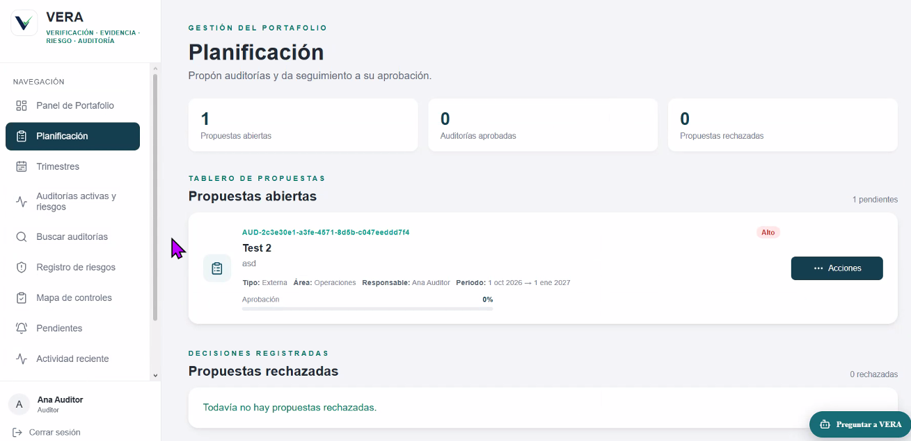
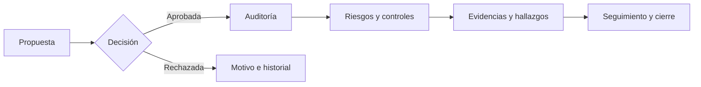

<p align="center"></p>

<h1 align="center">VERA</h1>

<p align="center"><strong>De la propuesta de auditoría a la decisión respaldada por evidencia.</strong></p>
<p align="center">Portafolio · riesgos · controles · evidencias · seguimiento</p>

<p align="center">
  
  
  
</p>

<p align="center">
  <a href="docs/wiki/Home.md">Centro de conocimiento</a> ·
  <a href="https://vera-salva-ventures.vercel.app">Abrir aplicación</a> ·
  <a href="https://github.com/humbertofigb15/VERA/actions/workflows/classroom-quality.yml">Ver calidad completa</a> ·
  <a href="docs/testing/professor-quick-run.md">Guía para docentes</a>
</p>

> **Estado del proyecto.** VERA es un prototipo académico con código funcional y pruebas automatizadas. La aplicación publicada exige una cuenta de VERA; el acceso universitario o a Azure DevOps no inicia sesión automáticamente. Un check verde acredita la verificación indicada, no la aceptación de todas las historias en producción. [Estado y límites por HU](docs/hu-acceptance-audit.md).

<p align="center"></p>
<p align="center"><sub>Vista real de Planificación compartida por el equipo · datos de demostración</sub></p>

## VERA en un minuto

| Pregunta | Respuesta de VERA |
| --- | --- |
| ¿Qué requiere atención? | Panel por rol con indicadores, matriz de riesgo, pendientes y acciones del portafolio. |
| ¿Cómo pasa una iniciativa a ejecución? | Propuesta → revisión y decisión → auditoría aprobada → seguimiento y cierre. |
| ¿Dónde está el sustento? | Riesgos y controles relacionados, hallazgos, archivos o referencias de evidencia, comentarios y actividad. |
| ¿Cómo se consulta el conjunto? | Búsqueda y filtros de auditorías; asistente de IA de consulta con fuentes visibles para cada usuario. |



El flujo se apoya en autorización del servidor y registros de actividad. La interfaz orienta al usuario; no sustituye los permisos de la API. El [centro de conocimiento](docs/wiki/Home.md) explica el recorrido, las reglas y sus límites.

## Explorar el producto

| Área | Qué permite hacer | Código principal |
| --- | --- | --- |
| **Panel de portafolio** | Consultar métricas, gráficas, auditorías y pendientes según el alcance del rol. | [Dashboard](frontend/src/pages/Dashboard.jsx) · [dashboardService](backend/services/dashboardService.js) |
| **Planificación** | Proponer auditorías, revisarlas y registrar aprobación o rechazo. | [Planificacion](frontend/src/pages/Planificacion.jsx) · [planningRoutes](backend/routes/planningRoutes.js) |
| **Auditorías** | Seguir expedientes activos, matriz 3 × 3 y búsqueda filtrada. | [AuditoriasActivas](frontend/src/pages/AuditoriasActivas.jsx) · [BuscarAuditorias](frontend/src/pages/BuscarAuditorias.jsx) |
| **Riesgos y controles** | Registrar evaluaciones versionadas, asociaciones y hallazgos. | [Riesgos](frontend/src/pages/Riesgos.jsx) · [Controles](frontend/src/pages/Controles.jsx) |
| **Evidencias y actividad** | Vincular referencias o archivos privados, consultar comentarios e historial. | [Evidencias](frontend/src/pages/Evidencias.jsx) · [auditRoutes](backend/routes/auditRoutes.js) |
| **Pendientes e IA** | Priorizar actividades y consultar información autorizada con citas y enlaces internos. | [Notificaciones](frontend/src/pages/Notificaciones.jsx) · [assistantRoutes](backend/routes/assistantRoutes.js) |

El asistente combina indicadores calculados por VERA con respuestas de Azure OpenAI. Las respuestas generadas pueden equivocarse: las citas identifican registros consultados, pero no certifican cada interpretación. El asistente no aprueba ni modifica expedientes; el [alcance y las salvaguardas](docs/ai-copilot-evolution.md) están documentados.

## Una revisión docente en tres pasos

1. **Entender la solución:** recorre el [centro de conocimiento](docs/wiki/Home.md), que separa producto, arquitectura, permisos y estado de aceptación.
2. **Ver resultados sin instalar nada:** abre [VERA — Calidad y pruebas completas](https://github.com/humbertofigb15/VERA/actions/workflows/classroom-quality.yml), elige una corrida y consulta *Summary*, logs y artefacto. La [guía de dos minutos](docs/testing/professor-quick-run.md) indica qué cubre y qué no.
3. **Inspeccionar la ingeniería:** revisa [calidad](https://github.com/humbertofigb15/VERA/actions/workflows/quality.yml), [navegadores](https://github.com/humbertofigb15/VERA/actions/workflows/e2e.yml), [CodeQL](https://github.com/humbertofigb15/VERA/actions/workflows/codeql.yml), [plan de pruebas](docs/testing/test-plan.md) y [PR fusionados](https://github.com/humbertofigb15/VERA/pulls?q=is%3Apr+is%3Amerged). Cada corrida indica el commit y la duración observada.

El workflow completo puede iniciarlo manualmente una persona con permiso de escritura; cualquier visitante puede leer las corridas públicas. La prueba de carga de 150/250 usuarios está **preparada, no acreditada como ejecutada**: requiere un staging autorizado. Los E2E usan fixtures de API y no sustituyen pruebas funcionales con cuentas reales y datos persistentes.

## Arquitectura y operación

| Capa | Implementación |
| --- | --- |
| Interfaz | React, Vite y React Router; clientes HTTP en `frontend/src/services/`. |
| API | Node.js 22 y Express; rutas, servicios, repositorios y autorización en `backend/`. |
| Identidad | JWT, bcryptjs y 2FA TOTP opcional; reglas de rol en [backend/config/roles.js](backend/config/roles.js). |
| Datos | Seis almacenes configurables: memoria para demo local o Supabase tras aplicar migraciones y activar dependencias. |
| IA | Azure OpenAI desde el backend; claves de servidor fuera del navegador y evaluación sintética reproducible. |
| Entrega | GitHub Actions para calidad, E2E y CodeQL; despliegue web con configuración independiente. |

La [arquitectura](docs/wiki/Arquitectura.md) y la [guía de Supabase](docs/supabase-planning.md) explican qué persiste, en qué orden se activa y cómo verificarlo. Un entorno local con `memory` no demuestra persistencia remota.

### Inicio local en PowerShell

Requiere **Node.js 22** y npm. Desde la raíz del repositorio:

```powershell
npm ci --prefix backend
npm ci --prefix frontend
Copy-Item .env.example .env
node -e "console.log(require('node:crypto').randomBytes(48).toString('base64'))"
```

Copia el valor generado a `JWT_SECRET` dentro de `.env`. No subas ese archivo ni uses datos reales en el modo demo. Después, en dos terminales:

```powershell
npm start --prefix backend
```

```powershell
npm run dev --prefix frontend
```

Vite indica la URL local de la interfaz. Los almacenes predeterminados son `memory`; la [guía de operación](docs/wiki/Operacion-y-despliegue.md) reúne variables, migraciones y límites del despliegue.

## Calidad con evidencia

| Verificación | Cómo se ejecuta | Qué demuestra |
| --- | --- | --- |
| Calidad de código | `npm run quality` y [workflow](https://github.com/humbertofigb15/VERA/actions/workflows/quality.yml) | Pruebas de backend con cobertura, sintaxis/lint, build y auditoría de dependencias del commit. |
| Interfaz | [Workflow E2E](https://github.com/humbertofigb15/VERA/actions/workflows/e2e.yml) | Flujos automatizados en navegadores y perfiles móvil/tablet con fixtures. |
| Seguridad estática | [CodeQL](https://github.com/humbertofigb15/VERA/actions/workflows/codeql.yml) | Análisis de JavaScript/TypeScript; no equivale a una auditoría de seguridad completa. |
| IA | [Evaluación continua manual](https://github.com/humbertofigb15/VERA/actions/workflows/ai-evaluation.yml) | Regresiones sintéticas del contrato y fuentes permitidas, sin llamada ni costo de Azure. |
| Aceptación | [Matriz de HU](docs/hu-acceptance-audit.md) y [runbook](docs/testing/operations-runbook.md) | Distinguen lo implementado, lo probado y lo pendiente en el entorno real. |

## Documentación y contribución

El **[centro de conocimiento de VERA](docs/wiki/Home.md)** es la puerta de entrada para lectura. Se conserva en `docs/wiki/` para revisión por PR; la publicación en la Wiki nativa de GitHub depende de que GitHub permita inicializar su primera página. Los runbooks de `docs/` y el código son la fuente técnica versionada para detalles que cambian. Si una página contradice una ruta o una prueba del commit actual, se corrige con la discrepancia documentada.

Para colaborar, parte de `main`, consulta [AGENTS.md](AGENTS.md) y la [guía para asistentes de código](docs/ai-development/README.md), mantén el PR enfocado y explica las verificaciones que **realmente** ejecutaste. Los resultados de CI y la revisión humana forman parte de la entrega.

<p align="center"><sub>VERA · Verificación, evidencia, riesgo y auditoría · Proyecto académico en evolución</sub></p>
