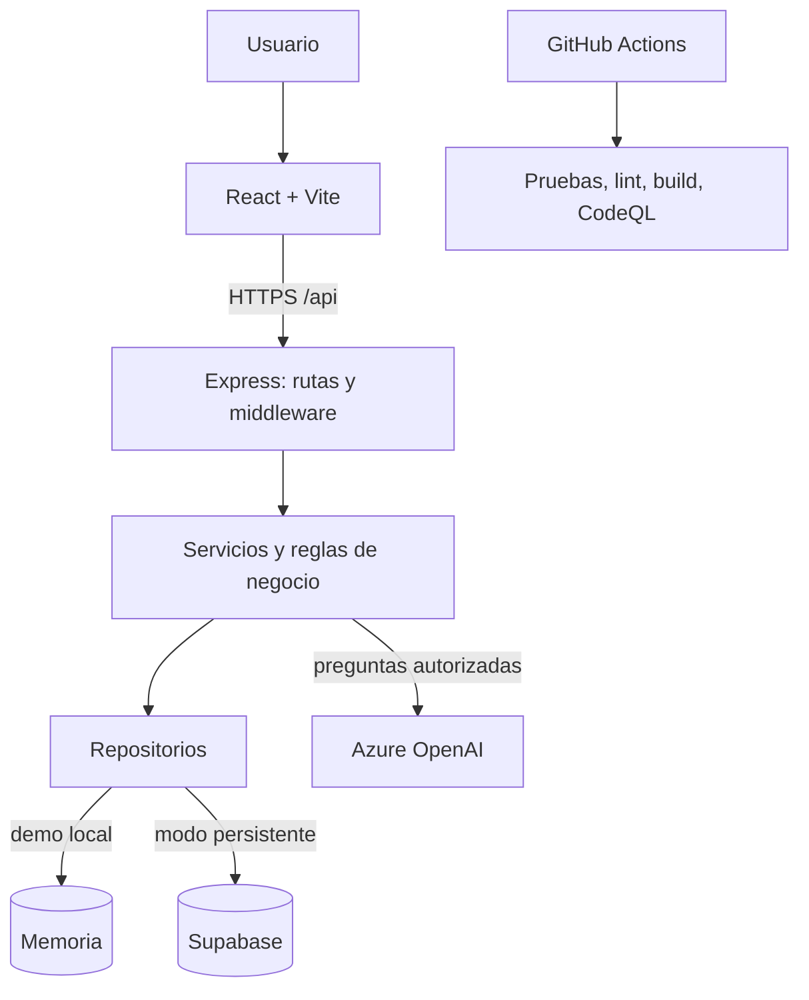

# Arquitectura

VERA separa presentación, reglas de negocio, repositorios y proveedores externos. El navegador no recibe claves de servidor. La API valida sesión, rol y visibilidad del registro antes de devolver datos o llamar al asistente.

## Dónde vive cada responsabilidad

| Responsabilidad | Fuente técnica |
| --- | --- |
| Rutas de interfaz y pantallas | [`frontend/src/App.jsx`](https://github.com/humbertofigb15/VERA/blob/main/frontend/src/App.jsx), `frontend/src/pages/` |
| Entradas HTTP | [`backend/server.js`](https://github.com/humbertofigb15/VERA/blob/main/backend/server.js), `backend/routes/` |
| Validación, contexto y reglas | `backend/controllers/`, `backend/services/` |
| Datos y adaptadores | `backend/repositories/`, [modos de almacén](https://github.com/humbertofigb15/VERA/blob/main/backend/config/storeModes.js) |
| Esquema persistente | [`supabase/migrations/`](https://github.com/humbertofigb15/VERA/tree/main/supabase/migrations) |
| Automatización | [`.github/workflows/`](https://github.com/humbertofigb15/VERA/tree/main/.github/workflows) |

## Dos entornos que no deben confundirse

- **Demo local:** los seis modos de almacén predeterminados son `memory`. Sirve para desarrollo y pruebas reproducibles; sus datos se pierden cuando reinicia el backend.
- **Persistencia Supabase:** cada almacén se activa por variable `VERA_*_STORE=supabase` tras aplicar migraciones y verificar dependencias. No basta con que exista el esquema; el entorno debe estar configurado y probado con sesiones reales.

El [mapa de dependencias](https://github.com/humbertofigb15/VERA/blob/main/docs/wiki/Datos-y-Supabase.md) y el [runbook de Supabase](https://github.com/humbertofigb15/VERA/blob/main/docs/supabase-planning.md) dan la secuencia exacta.

## Principios de diseño verificables

1. El backend aplica la autorización; `ProtectedRoute` y el menú son ayudas de interfaz.
2. Los fallos de almacenamiento persistente no se deben presentar como éxito con datos temporales.
3. Las respuestas de IA citan solo fuentes del catálogo visible al usuario y no tienen herramientas de escritura.
4. La prueba con mocks, el check de CI y la aceptación en producción se reportan por separado.

**Para cambios:** lee [`AGENTS.md`](https://github.com/humbertofigb15/VERA/blob/main/AGENTS.md) y la guía específica del directorio afectado.
