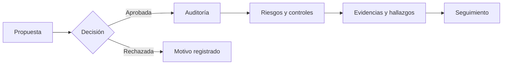

# VERA · Centro de conocimiento

**Una sola vista del recorrido de auditoría.** Explora el producto, la arquitectura, los permisos, la operación y la evidencia de calidad sin perder el contexto de cada decisión. Esta Wiki está organizada para docentes, usuarios de negocio y personas que construyen u operan VERA.

> **Cómo leer el estado:** VERA es un prototipo académico en evolución. «Implementado en código», «aprobado en CI» y «aceptado en producción» son afirmaciones distintas. Consulta [Estado y evidencias](https://github.com/VERA-GRC-IRM/VERA/wiki/Modulos-y-HU) antes de cerrar una HU.

## Empieza por lo que necesitas

| Si quieres... | Empieza aquí | Después |
| --- | --- | --- |
| Entender la solución en 5 minutos | [Producto y flujos](https://github.com/VERA-GRC-IRM/VERA/wiki/Producto-y-flujos) | [Módulos y HU](https://github.com/VERA-GRC-IRM/VERA/wiki/Modulos-y-HU) |
| Evaluar al equipo sin instalar software | [Portal público de calidad](https://vera-grc-irm.github.io/VERA/) | [Calidad y pruebas](https://github.com/VERA-GRC-IRM/VERA/wiki/Calidad-y-pruebas) |
| Comprender cómo funciona | [Arquitectura](https://github.com/VERA-GRC-IRM/VERA/wiki/Arquitectura) | [Datos y Supabase](https://github.com/VERA-GRC-IRM/VERA/wiki/Datos-y-Supabase) |
| Revisar quién puede hacer qué | [Acceso y permisos](https://github.com/VERA-GRC-IRM/VERA/wiki/Acceso-y-permisos) | [Política vigente en código](https://github.com/VERA-GRC-IRM/VERA/blob/main/backend/config/roles.js) |
| Conocer la IA | [IA de VERA](https://github.com/VERA-GRC-IRM/VERA/wiki/IA-de-VERA) | [Evaluación continua](https://github.com/VERA-GRC-IRM/VERA/blob/main/docs/ai-continuous-evaluation.md) |
| Desarrollar o desplegar | [Contribuir](https://github.com/VERA-GRC-IRM/VERA/wiki/Contribuir) | [Operación y despliegue](https://github.com/VERA-GRC-IRM/VERA/wiki/Operacion-y-despliegue) |
| Encontrar un documento técnico | [Biblioteca de runbooks](https://github.com/VERA-GRC-IRM/VERA/wiki/Biblioteca-de-runbooks) | [Glosario](https://github.com/VERA-GRC-IRM/VERA/wiki/Glosario) |

## Cómo se conecta todo

VERA reúne propuesta, decisión, auditoría, riesgo, control, evidencia y seguimiento en un mismo recorrido, con datos visibles según los permisos del usuario.

## Accesos directos

- [Repositorio y README](https://github.com/VERA-GRC-IRM/VERA) · [Despliegue del equipo](https://vera-figbo.vercel.app) — requiere acceso a Vercel y cuenta de VERA.
- [Portal de calidad actualizado](https://vera-grc-irm.github.io/VERA/) · [Workflow integral para docentes](https://github.com/VERA-GRC-IRM/VERA/actions/workflows/classroom-quality.yml) · [PR fusionados](https://github.com/VERA-GRC-IRM/VERA/pulls?q=is%3Apr+is%3Amerged).
- [Plan de pruebas](https://github.com/VERA-GRC-IRM/VERA/blob/main/docs/testing/test-plan.md) · [Matriz de aceptación](https://github.com/VERA-GRC-IRM/VERA/blob/main/docs/hu-acceptance-audit.md).

**Fuentes de verdad.** La Wiki explica y orienta; el comportamiento vigente se verifica en el código de `main`, sus pruebas y el entorno concreto. Los runbooks de `docs/` son la referencia operativa versionada. La versión revisable de estas páginas vive en [`docs/wiki/`](https://github.com/VERA-GRC-IRM/VERA/tree/main/docs/wiki). Si se contradicen, registra el archivo y el commit antes de corregir la página.
