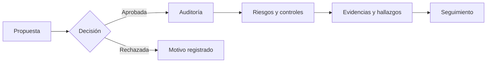

# VERA · Centro de conocimiento

**Verificación, evidencia, riesgo y auditoría.** Esta Wiki conecta la experiencia del producto con sus decisiones de diseño, controles técnicos y evidencia de calidad. Está escrita para docentes, usuarios de negocio, personas desarrolladoras y responsables de operación.

> **Publicación:** esta versión está disponible en `docs/wiki/` y se revisa mediante PR. La Wiki nativa de GitHub todavía necesita que su primera página se inicialice; hasta entonces estos enlaces llevan a la versión completa dentro del repositorio.

> **Cómo leer el estado:** VERA es un prototipo académico en evolución. «Implementado en código», «aprobado en CI» y «aceptado en producción» son afirmaciones distintas. Consulta [Estado y evidencias](https://github.com/humbertofigb15/VERA/blob/main/docs/wiki/Modulos-y-HU.md) antes de cerrar una HU.

## Elige tu recorrido

| Si quieres... | Empieza aquí | Después |
| --- | --- | --- |
| Entender la solución en 5 minutos | [Producto y flujos](https://github.com/humbertofigb15/VERA/blob/main/docs/wiki/Producto-y-flujos.md) | [Módulos y HU](https://github.com/humbertofigb15/VERA/blob/main/docs/wiki/Modulos-y-HU.md) |
| Evaluar al equipo sin instalar software | [Calidad y pruebas](https://github.com/humbertofigb15/VERA/blob/main/docs/wiki/Calidad-y-pruebas.md) | [Guía rápida docente](https://github.com/humbertofigb15/VERA/blob/main/docs/testing/professor-quick-run.md) |
| Comprender cómo funciona | [Arquitectura](https://github.com/humbertofigb15/VERA/blob/main/docs/wiki/Arquitectura.md) | [Datos y Supabase](https://github.com/humbertofigb15/VERA/blob/main/docs/wiki/Datos-y-Supabase.md) |
| Revisar quién puede hacer qué | [Acceso y permisos](https://github.com/humbertofigb15/VERA/blob/main/docs/wiki/Acceso-y-permisos.md) | [Política vigente en código](https://github.com/humbertofigb15/VERA/blob/main/backend/config/roles.js) |
| Conocer la IA | [IA de VERA](https://github.com/humbertofigb15/VERA/blob/main/docs/wiki/IA-de-VERA.md) | [Evaluación continua](https://github.com/humbertofigb15/VERA/blob/main/docs/ai-continuous-evaluation.md) |
| Desarrollar o desplegar | [Contribuir](https://github.com/humbertofigb15/VERA/blob/main/docs/wiki/Contribuir.md) | [Operación y despliegue](https://github.com/humbertofigb15/VERA/blob/main/docs/wiki/Operacion-y-despliegue.md) |
| Encontrar un documento técnico | [Biblioteca de runbooks](https://github.com/humbertofigb15/VERA/blob/main/docs/wiki/Biblioteca-de-runbooks.md) | [Glosario](https://github.com/humbertofigb15/VERA/blob/main/docs/wiki/Glosario.md) |

## La idea en una frase

VERA reúne propuesta, decisión, auditoría, riesgo, control, evidencia y seguimiento en un mismo recorrido, con datos visibles según los permisos del usuario.

## Enlaces directos

- [Repositorio y README](https://github.com/humbertofigb15/VERA) · [Aplicación publicada](https://vera-salva-ventures.vercel.app) — requiere cuenta de VERA.
- [Workflow integral para docentes](https://github.com/humbertofigb15/VERA/actions/workflows/classroom-quality.yml) · [PR fusionados](https://github.com/humbertofigb15/VERA/pulls?q=is%3Apr+is%3Amerged).
- [Plan de pruebas](https://github.com/humbertofigb15/VERA/blob/main/docs/testing/test-plan.md) · [Matriz de aceptación](https://github.com/humbertofigb15/VERA/blob/main/docs/hu-acceptance-audit.md).

**Fuentes de verdad.** La Wiki explica y orienta; el comportamiento vigente se verifica en el código de `main`, sus pruebas y el entorno concreto. Los runbooks de `docs/` son la referencia operativa versionada. Si se contradicen, registra el archivo y el commit antes de corregir la página.
